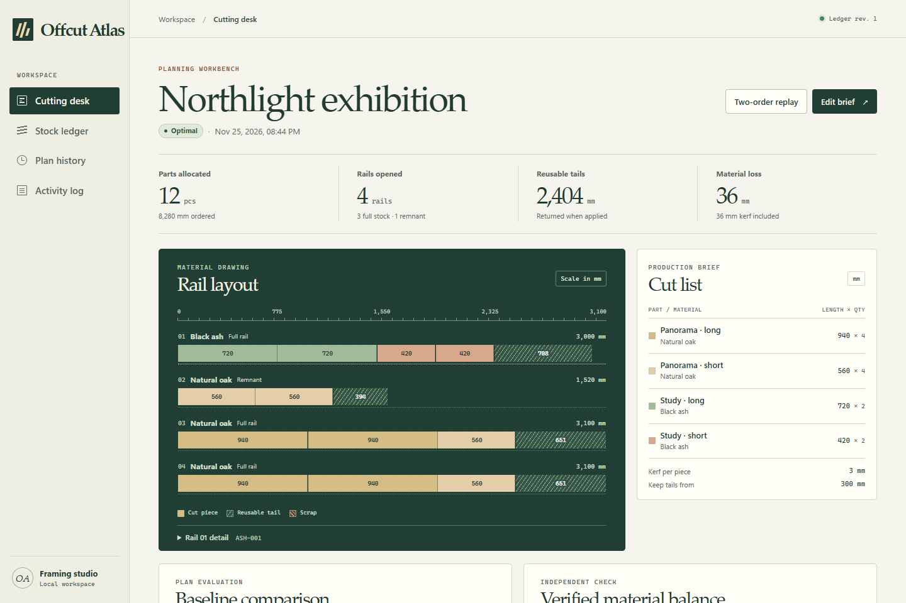
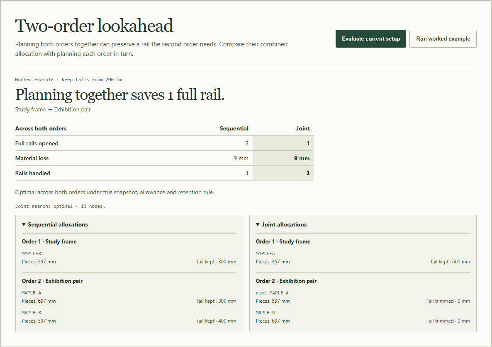

# Offcut Atlas

Offcut Atlas is a local planning workbench for a picture-framing studio. It takes a commission from a list of finished lengths through a verified cut drawing, a stock booking, a printable shop sheet and a rack of traceable leftovers. A second workspace lets the studio test how today's choice affects a known follow-up order.



## Run it

Requires Python 3.12. The application uses its standard library and ships all browser assets. From the repository directory, run:

```console
python -m atlas serve
```

Open [the cutting desk](http://127.0.0.1:8764). First launch creates a local SQLite ledger and computes the synthetic **Northlight exhibition** order. Ctrl+C stops a foreground server. To use an empty inventory in a separate database, run `python -m atlas serve --empty --db var/new-studio.sqlite3 --port 8765`.

## Five-minute walkthrough

1. Open **Northlight exhibition**. Its 12 finished pieces total 8,280 mm. Select a rail in the drawing to inspect its allocation. Open the verification checks beneath the drawing.
2. Compare the greedy baseline with the selected plan. Both open three fresh rails. The selected plan uses four rails overall, returns 2,404 mm in eligible tails and loses 36 mm. The baseline uses seven rails and loses 536 mm.
3. Open **Two-order replay**. Change the follow-up quantity or retention threshold and compare the outcomes. Scroll to **Two-order lookahead → Run worked example**. Planning separately spends the 700 mm maple remnant on the first order. Planning jointly cuts the first 397 mm piece from fresh stock, creating a 600 mm tail. The next order can then use both the original remnant and the new tail. Open either allocation to follow its stock IDs.
4. Return to the desk. **Edit brief** and submit a revision. The earlier run and its input snapshot remain in **Plan history**. Use **Apply to ledger** on a verified plan when you want to book it. An earlier plan that used the same physical rail can no longer be booked.
5. Open **Print cut sheet** after booking to see the new remnant labels. In **Stock ledger**, filter to remnants and follow **Source plan**. **Export packet** downloads the snapshot and feasibility evidence for offline checking.

```console
python -m atlas.check docs/evidence/northlight-packet.json
```



## What the numbers mean

The single-order planner first minimizes fresh rails opened, then irreversible loss in millimetres, then total rails handled. Every piece incurs one full kerf. A tail at the reuse threshold returns to stock. Material names identify compatible profiles. The joint planner applies the same priorities across both orders, including the inventory transition between them.

The single-order solver supports **128 available rails and 96 requested pieces** through the workbench, with a 60,000-node search budget. The two-order lookahead supports **seven relevant rails and ten pieces total**. A feasible budget-limited result may have a better undiscovered alternative. A completed search can establish optimality for the stated model. The separate certificate checks exact demand, material compatibility, quantities, conservation and all seven totals. All optimization takes place locally.

## Evidence

| Check | Observed result |
| --- | --- |
| Single-order search | Matched an exhaustive reference on 160 seeded tiny orders in the shipped suite. |
| Joint lookahead | Matched an independently implemented two-period oracle on 160 seeded order pairs, including mixed materials, different kerfs and infeasibility. |
| Planner versus independent first fit | 15 improvements and one tie across 16 feasible primary benchmark fixtures. Another fixture was infeasible. In 45 further generated cases, the bounded planner improved 44 and lost one. |
| End-to-end browser | Exercised on desktop Chromium at 1440 × 960 and a 390 × 844 mobile viewport. Coverage includes drawing inspection, experiments, stock intake retry, stale-plan rejection, packet download and printable labels. |
| State recovery | Concurrent duplicate submissions, competing bookings, partial transaction rollback, expired job claims, v1 → v2 migration and backup reopening covered by tests. |

Run the checks locally:

```console
python -m unittest discover -s tests -v
python tools/benchmark.py --seed 614 --output var/benchmark.json
python tools/horizon_check.py --corpus
```

The optional browser suite uses Playwright. Install it in a test environment, then run:

```console
python -m pip install playwright==1.64.1
python -m playwright install chromium
python tests/browser_smoke.py
```

For an existing Chromium installation, add `--executable "path/to/chrome"`. The browser suite uses disposable ledgers. The included GitHub Actions workflow defines Linux and Windows unit jobs plus a Linux browser job. Local results are recorded in the [release verification](docs/verification.md), [machine-readable benchmark](docs/evidence/benchmark.json), and [offline example packet](docs/evidence/northlight-packet.json).

## Container and handover

Run `docker compose up --build -d` on a host with a running Docker engine and port 8764 free. The Compose configuration publishes only to loopback and persists the ledger in a named volume. Use `docker compose down` to stop it. The native Python route is the configuration exercised on the delivery machine.

| Guide | Contents |
| --- | --- |
| [Design and research](docs/design.md) | Candidate directions, selection criteria, primary sources and acceptance criteria |
| [Planner](docs/solver.md) | Objective, bounds, symmetry, local improvements and search statuses |
| [Independent verification](docs/proof.md) | Certificate scope, objective comparison and a benchmark case the bounded solver lost |
| [Two-order evaluation](docs/replay-evaluation.md) | Hand-checkable examples and the independent exhaustive reference |
| [Operations and threat model](docs/operations.md) | Architecture, schema, queue recovery, safe booking, backup, restoration and code map |
| [HTTP API v1](docs/api.md) | Request examples, endpoints, limits, errors and retry semantics |
| [Release verification](docs/verification.md) | Executed checks, artifacts and deployment boundaries |

The commissioning and benchmark datasets are synthetic. The geometry assumes linear, interchangeable stock within each named profile. A shop must supply lengths that already account for its actual mitres, end trimming and defects. The software produces planning records and has no machinery interface. Field yield, operator usability and public multi-user deployment have not been validated.
