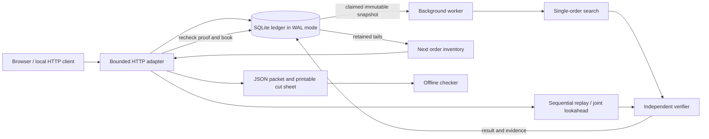
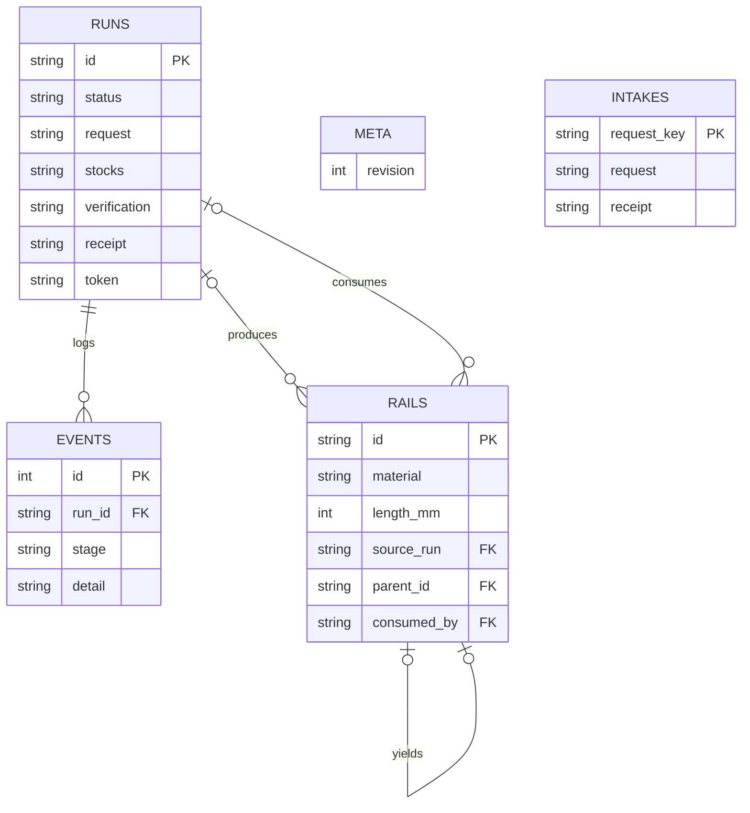

# Architecture and operations

The worker, solver, verifier and ledger have distinct responsibilities. The product uses deterministic search and verification. It requires no model endpoint. The development work included parallel independent engineering, testing and review.

## Booking and recovery

The queue shares a transaction with snapshot creation. A worker claims the oldest eligible run, saves a unique token and leases it for 90 seconds. A worker that crashes leaves its job eligible for reclaim after expiry. A late completion must match the current token. Four interrupted attempts produce an inspectable failure. Each worker runs one planner at a time. Live pages poll while waiting for completion.

A booking runs under SQLite `BEGIN IMMEDIATE`. It rechecks the certificate digest, consumes each selected rail by conditional update, creates eligible child rails, records the event and advances the inventory revision in one transaction. Reapplying a booked plan returns its original receipt. A conflict rolls back every change made during that attempt. Each child records both its parent rail and the producing job. The print view turns a committed run into a cut sheet with labels for returned stock. [SQLite transaction model](https://sqlite.org/lang_transaction.html)

The default DB is `var/studio.sqlite3`. A new database receives a single demonstration commission unless started with `--empty`. Startup applies schema versions transactionally, including version 2's stock receipt keys. An existing DB is never reseeded. Use `--db` to isolate studios or experiments. The recent activity views show at most 100 entries each. Older runs remain retrievable by ID.

## Backup and restoration

Run `python -m atlas backup backups/studio-1.sqlite3 --db var/studio.sqlite3` while the service is running. The SQLite backup interface takes a consistent snapshot and runs an integrity check. Choose a new destination name. To verify a restore without overwriting the active studio, start a second instance with `python -m atlas serve --db backups/studio-1.sqlite3 --port 8765` and open its loopback URL. Stop it before storing the restore copy. Additional writes to that instance will update its DB.

## Security and operating envelope

| Boundary | Implementation | Residual risk |
| --- | --- | --- |
| Browser to service | Loopback host allowlist, same-origin write checks, bounded JSON, unique keys, escaped text and CSP | Local processes and same-user clients have full access. |
| Service to ledger | Parameterized SQL, immutable snapshots, transactional state and idempotency keys | A person with filesystem write access can alter the database. |
| Solver to booking | Independent arithmetic, digest binding, unique physical IDs, atomic conditional updates | Accuracy depends on measured stock and material profiles. |
| Work scheduling | 24 pending/running jobs, 24 concurrent connections, bounded search, one user replay at a time | No multi-user isolation or network-facing service-level guarantee. |
| Packet to offline reader | Deterministic SHA-256 and optional trusted digest | The digest does not authenticate the publisher or booking receipt. |

Deploy on a trusted workstation. Use the supplied container mapping only with loopback publication. The HTTP adapter serves a fixed static asset manifest. It has no endpoint that executes commands, calls providers or controls machinery. Keep the SQLite volume on a local filesystem suitable for WAL. Production multi-tenant service would require authentication, authorization, TLS termination, operational monitoring and workload isolation.

## Developer handover

- `atlas/validation.py` defines intake and order contracts.
- `atlas/solver.py`, `_cut_model.py` and `_cut_refine.py` implement one-order search, representation and local refinements.
- `atlas/horizon.py` explores both known orders, carrying physical tails across the order boundary. Equivalent rails at a given search depth share material, capacity, kind, opening state and original size, so the search only explores one representative. Each winning stage goes through the independent verifier.
- `atlas/proof.py` and `check.py` reconstruct allocations and check portable evidence.
- `atlas/ledger.py`, `schema.sql` and `worker.py` own persistence and recovery.
- `atlas/replay.py` connects the two planners to immutable experiments. `atlas/demo.py` owns both synthetic fixtures.
- `atlas/server.py` defines the local HTTP and security boundary. `atlas/static/` contains the three browser views.
- `tools/` contains the independent benchmark and tiny two-period oracle. Preserve these independent checks when changing the planner or objective.
